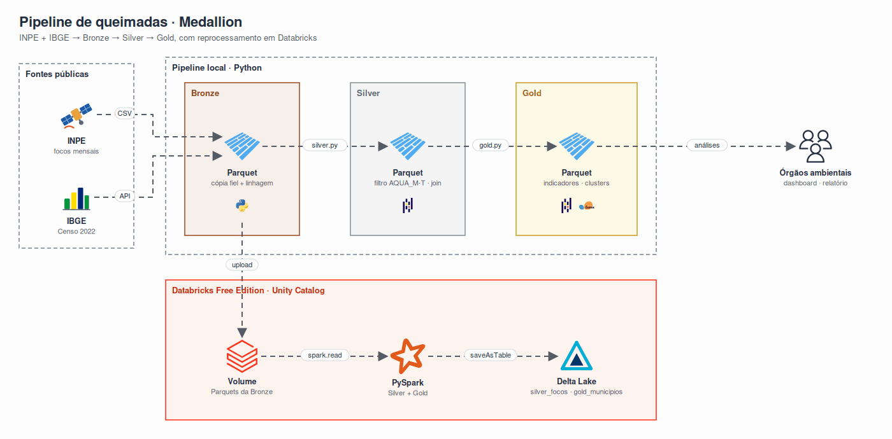
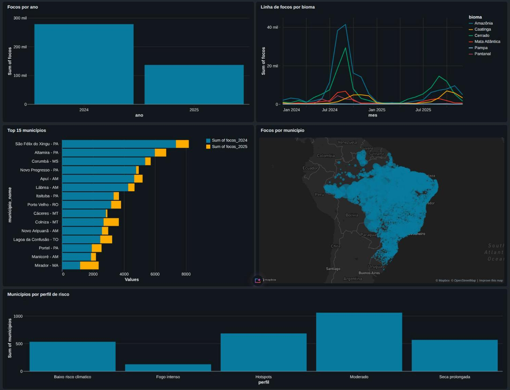
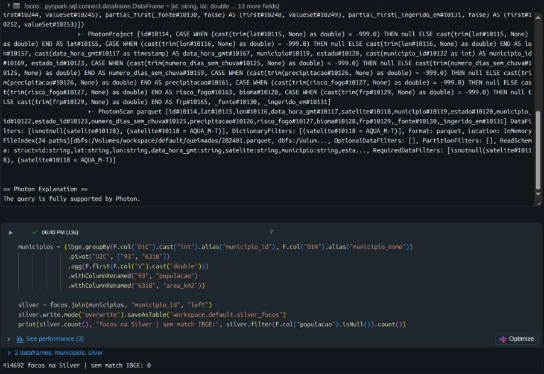

# CitizenTech: Queimadas no Brasil (2024-2025)

**Aluno:** Luiz Brito · **Data:** 08/11/2026 · **Disciplina:** Big Data & Analytics (Global Solution)

Pipeline de Big Data & Analytics para entender onde, quando e em que condições ocorrem os focos de queimada no Brasil, e apoiar a priorização de ações de prevenção e fiscalização.

## 1. Investigação do problema

**Problema:** focos de queimada são uma emergência climática recorrente, com impacto em saúde respiratória, biodiversidade, emissões de carbono e economia local.

**Quem é afetado:** populações de municípios com alta incidência de fogo (principalmente Amazônia e Cerrado), órgãos ambientais (IBAMA, ICMBio, secretarias estaduais), Defesa Civil e brigadas de incêndio.

**Dimensão analisada:** distribuição geográfica (município e bioma), evolução mensal, condições climáticas associadas (dias sem chuva, precipitação, risco de fogo) e intensidade do fogo (FRP).

**Decisões que os dados apoiam:**

- Onde posicionar brigadas e recursos de combate antes do período crítico.
- Quais municípios precisam de fiscalização (fogo fora de condição climática de risco).
- Quando antecipar campanhas de prevenção.

**Viabilidade:** o INPE publica os focos com dados abertos, granularidade por foco e código IBGE do município, o que permite cruzar com dados demográficos oficiais.

## 2. Catálogo de dados

| Fonte | Origem | Volume | Atributos usados |
|---|---|---|---|
| Focos de queimada (mensal, Brasil) | [INPE BDQueimadas](https://dataserver-coids.inpe.br/queimadas/queimadas/focos/csv/mensal/Brasil/) | 24 arquivos, 11.608.772 focos (todos os satélites) | `id`, `lat`, `lon`, `data_hora_gmt`, `satelite`, `municipio_id`, `estado`, `bioma`, `numero_dias_sem_chuva`, `precipitacao`, `risco_fogo`, `frp` |
| Censo 2022: população, área e densidade | [IBGE SIDRA, tabela 4714](https://apisidra.ibge.gov.br/values/t/4714/n6/all/v/93,6318,614/p/2022) | 5.570 municípios | código do município, população, área (km²), densidade |

**Por que essas fontes:**

- O INPE é a referência oficial de monitoramento de fogo no Brasil. O arquivo mensal traz variáveis climáticas por foco, que o arquivo anual não tem.
- O IBGE permite normalizar os focos por área e população, evitando que municípios grandes dominem os rankings só pelo tamanho.
- A chave de integração é o código IBGE do município (`municipio_id`), presente nas duas fontes.

**Confiabilidade:**

- Foi usado apenas o **satélite de referência (AQUA_M-T)**, que forma a série histórica oficial do INPE. Validação: setembro/2024 tem 83.154 focos tanto no arquivo mensal filtrado quanto no arquivo anual oficial de referência, e o total de 2024 (278.299) também bate.
- O valor `-999` é usado pelo INPE para "sem dado" e foi convertido em nulo (menos de 2% dos registros).
- Classes de risco seguem o método oficial do INPE ([RiscoFogo_Sucinto.pdf](https://dataserver-coids.inpe.br/queimadas/queimadas/Publicacoes-Impacto/documentos/RiscoFogo_Sucinto.pdf)).

## 3. Arquitetura (Medallion)

<p align="center"></p>

| Camada | Conteúdo | Decisões |
|---|---|---|
| **Bronze** | Dados originais de todos os satélites, colunas como texto | Parquet em vez de CSV (408 MB de CSV viram ~50 MB). Colunas `_fonte` e `_ingerido_em` para rastreabilidade. Ingestão idempotente (pula meses já baixados). |
| **Silver** | 414.692 focos do satélite de referência, tipados e integrados ao IBGE | Filtro aplicado na leitura do Parquet. `-999` vira nulo. Deduplicação por `id`. Join pelo código IBGE: 0 focos sem correspondência. |
| **Gold** | `municipios` (5.570 linhas), `bioma_mes` (144 linhas), `correlacao_clima`, `clusters` | Inclui municípios com zero focos, necessário para taxas e comparações justas. |

**Tecnologias:** Python, pandas, PyArrow (Parquet), scikit-learn, SciPy. Databricks Free Edition com PySpark e Delta Lake na parte de processamento distribuído.

## 4. Como executar

```bash
uv sync
uv run python bronze.py    # baixa INPE + IBGE (alguns minutos, ~615 MB)
uv run python silver.py
uv run python gold.py
uv run python analise.py
```

Databricks: importar `databricks/queimadas_spark.py`, enviar os Parquets da Bronze para o volume `workspace.default.queimadas` e executar.

## 5. Feature Engineering

| Feature | Construção | Por que importa |
|---|---|---|
| `classe_risco` | `risco_fogo` em 5 faixas oficiais do INPE (mínimo a crítico) | Traduz um índice contínuo em categorias usadas pelos órgãos de resposta |
| `pct_risco_critico` | % de focos do município com risco > 0,95 | Separa fogo em condição climática extrema de fogo "fora de época" |
| `focos_por_1000km2` | focos / área × 1000 | Normaliza pelo tamanho do município |
| `focos_por_100mil_hab` | focos / população × 100.000 | Mede exposição da população |
| `var_anual_pct` | (focos 2025 - focos 2024) / focos 2024 | Mostra tendência por município |
| `frp_medio` | média do Fire Radiative Power | Intensidade do fogo, proxy de severidade |
| `bioma_predominante` | bioma mais frequente nos focos do município | Contexto ecológico para a recomendação |
| `ano`, `ano_mes` | extraídos de `data_hora_gmt` | Base para sazonalidade e evolução |

## 6. Indicadores

| Indicador | Definição | Dados | Interpretação |
|---|---|---|---|
| Total de focos | contagem de focos do satélite de referência | INPE | Dimensão do problema. 2024: 278.299; 2025: 136.393 (queda de 51%) |
| Densidade de focos | focos por 1.000 km² | INPE + IBGE | Prioriza onde o fogo é concentrado, não só onde o território é grande. Usar com volume mínimo (municípios pequenos distorcem) |
| Focos por 100 mil hab. | focos / população | INPE + IBGE | Exposição humana |
| % em risco crítico | focos com risco de fogo > 0,95 | INPE | Alto: fogo ligado à seca. Baixo: indício de queima por manejo ou ação humana |
| FRP médio | intensidade média | INPE | Severidade, ajuda a dimensionar o tipo de combate |
| Focos por bioma e mês | contagem mensal por bioma | INPE | Sazonalidade: pico de agosto a outubro |

## 7. Análises avançadas

**Correlação clima × focos** (Spearman, por bioma, 24 meses):

| Bioma | Dias sem chuva | Precipitação |
|---|---|---|
| Cerrado | 0,88 | -0,78 |
| Mata Atlântica | 0,82 | -0,51 |
| Caatinga | 0,74 | -0,42 |
| Pantanal | 0,63 | -0,28 (não sig.) |
| Amazônia | 0,52 | -0,49 |
| Pampa | 0,24 (não sig.) | -0,14 (não sig.) |

Spearman foi escolhido porque os focos têm distribuição muito assimétrica (de 30 mil a 800 mil por mês).

**Clusterização de municípios** (KMeans, k = 5 escolhido pela silhueta, municípios com 10 ou mais focos, features padronizadas):

| Perfil | Municípios | Característica |
|---|---|---|
| Hotspots | 683 | 70% de todos os focos |
| Seca prolongada | 566 | 63 dias sem chuva, 86% em risco crítico |
| Fogo intenso | 123 | FRP cerca de 4× a média |
| Moderado | 1.059 | 20 dias sem chuva, 75% em risco crítico |
| Baixo risco climático | 532 | só 11% em risco crítico: fogo fora da seca |

**Limitações:** silhueta de 0,25 indica grupos com sobreposição, então os perfis servem para priorizar, não como categorias rígidas. Apenas dois anos de dados, e 2024 foi um ano de seca extrema, o que exagera a queda em 2025.

## 8. Dashboard

AI/BI Dashboard no Databricks, alimentado pelas tabelas Delta `silver_focos` e `gold_municipios` e pelos clusters. As consultas estão em [`databricks/dashboard.sql`](databricks/dashboard.sql).

<p align="center"></p>

## 9. Experimentação com Databricks e Apache Spark

Notebook [`databricks/queimadas_spark.py`](databricks/queimadas_spark.py), executado no Databricks Free Edition (compute serverless com Photon).

| O que foi investigado | Como foi feito |
|---|---|
| Carregar datasets | `spark.read.parquet` sobre os 24 Parquets da Bronze num volume do Unity Catalog (11,6 milhões de linhas) |
| Transformações em DataFrames | filtro de satélite, `trim` + `cast`, `-999` para nulo, `to_timestamp`, `dropDuplicates` |
| Junção de fontes | pivot do IBGE (`groupBy().pivot()`) e `join` pelo código do município |
| Agregações e consultas | `groupBy().agg()` por município e consulta SQL (`%sql`) sobre a tabela Gold |
| Armazenar e consultar | `saveAsTable` em Delta Lake (`silver_focos`, `gold_municipios`), consumidas pelo dashboard |
| Processamento distribuído | leitura em paralelo dos 24 arquivos e plano físico analisado com `explain()` |

<p align="center"></p>

**O que o plano físico mostra:**

- O filtro `satelite = AQUA_M-T` aparece dentro do `PhotonScan parquet` (`DataFilters` e `DictionaryFilters`). O Spark descarta as linhas dos outros satélites já na leitura, sem carregar os 11,6 milhões de registros para depois filtrar.
- As colunas `pais` e `pais_id`, removidas no código, nem são lidas do arquivo (*column pruning*).
- O resultado bate com o pipeline local: 414.692 focos na Silver, 0 sem correspondência no IBGE e o mesmo ranking de municípios na Gold.

**Discussão:**

- **Características:** a mesma lógica do pandas foi escrita de forma declarativa e o otimizador decidiu a ordem de execução. As tabelas Delta ficaram disponíveis direto para SQL e para o dashboard, sem exportar arquivos.
- **Possibilidades:** com o histórico completo do INPE (desde 2003, todos os satélites), o volume passa de centenas de milhões de linhas e não cabe na memória de uma máquina. Nesse cenário o Spark escala sem mudar o código.
- **Limitações:** com o volume atual (cerca de 415 mil focos filtrados), o pandas local foi mais simples e rápido de iterar. O serverless leva alguns segundos para iniciar. O modo ANSI do SQL dá erro em divisão por zero, o que exigiu `NULLIF`. Na Free Edition o dashboard não tem link público: só usuários cadastrados na conta conseguem abrir.
